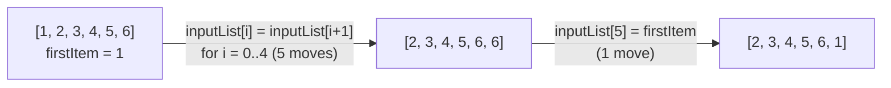
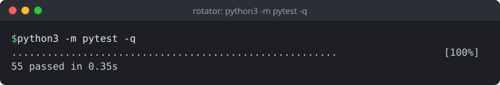

# Challenge: Rotate a list by k elements
Write a function that rotates a list by k elements. For example, [1, 2, 3, 4, 5, 6] rotated by two becomes [3, 4, 5, 6, 1, 2]. 

Try solving this without creating a copy of the list. How many swap or move operations do you need?

![Terminal running python3 main.py: the list [1, 2, 3, 4, 5, 6] is printed before one left rotation and [2, 3, 4, 5, 6, 1] after it](docs/screenshots/demo.svg)

## Solution
`Rotator` in `rotator.py` rotates a list to the left, in place, without creating a copy of it.

- `rotate(inputList)` shifts every element one position to the left and moves the original first element to the end. The caller's list is mutated and nothing is returned.
- `rotateRepeat(inputList, numRotations)` calls `rotate` on the list `numRotations` times, skipping whole cycles: every `n` rotations of an `n`-element list restore the original order, so a count of `n` or more is first reduced modulo `n`.

### Move count
`rotate` saves the first element, shifts the remaining `n - 1` elements one position to the left, and then writes the saved element into the last position — `n` moves for a list of `n` elements. `rotateRepeat` repeats that `k mod n` times, so rotating by a non-negative `k` costs `n * (k mod n)` moves.

One call to `rotate` on `[1, 2, 3, 4, 5, 6]`, step by step (traced from `rotator.py`):



## Running the demo
```
python3 main.py
```

`main.py` rotates `[1, 2, 3, 4, 5, 6]` once and prints the list before and after:

```
Num rotations: 1

Before:
[1, 2, 3, 4, 5, 6]

After:
[2, 3, 4, 5, 6, 1]
```

## Running the tests
The tests are written for pytest.

```
python3 -m pytest
```

Run that from the repository root, or pass the repository path from any other directory (`python3 -m pytest path/to/rotator`). The repository has no packaging and no `conftest.py`, but pytest prepends the directory holding each test file to `sys.path`, so `test_rotator.py` and `test_main.py` import `rotator` and `main` as top-level modules either way.

## Screenshots
All images below are real output captured from this repository, not mockups.

![Terminal running a python3 -c snippet that rotates [1, 2, 3, 4, 5, 6] by k = 2, 6 and 8: k = 2 and k = 8 both give [3, 4, 5, 6, 1, 2], and k = 6 returns the original list](docs/screenshots/rotate-repeat.svg)

*`rotateRepeat` with `k = 2` gives the challenge's expected `[3, 4, 5, 6, 1, 2]`; `k = 6` (a whole cycle) restores the list, and `k = 8` is reduced to `8 mod 6 = 2`.*



*The pytest suite passing.*

### Regenerating screenshots
`python3 docs/screenshots/render_terminal.py` reruns each command from the repository root and rewrites the SVGs in `docs/screenshots/` with its actual output.

## License
This project is licensed under the Stephenson Software Non-Commercial License (Stephenson-NC). Use, copying, modification, and distribution are permitted for non-commercial purposes only, and commercial use by any party other than the copyright holder requires explicit written permission.

The terms that apply to this repository are in [`LICENSE`](LICENSE). The full license text is published at https://github.com/Stephenson-Software/stephenson-nc-license.
